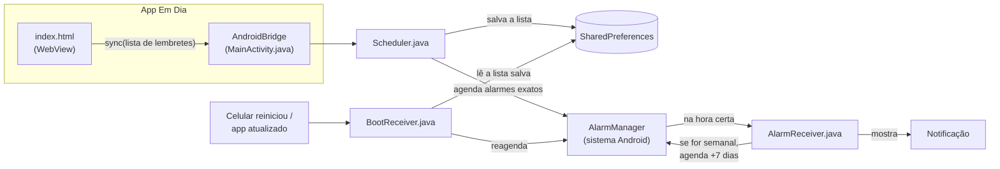

# Em Dia

Quadro de tarefas semanal, no estilo Trello, com uma coluna para cada dia de segunda a domingo e lembretes por notificação.

> Projeto de **Lucas Montechiari**, desenvolvido com o auxílio do **Claude**, assistente de IA da Anthropic. Veja [Créditos](#créditos).

O mesmo app roda em três lugares:

| Onde | Arquivo | Lembretes |
|---|---|---|
| **Android** (app instalável) | [`mobile/EmDia.apk`](mobile/EmDia.apk) | Chegam mesmo com o app fechado |
| **iPhone e Android** (app web instalável) | [`mobile/www/`](mobile/www) | Chegam com o app aberto |
| **Computador** | [`em-dia.html`](em-dia.html) | Chegam com a aba aberta |

---

## Recursos

- **Sete colunas**, de segunda a domingo, com a data da semana atual. O dia de hoje fica destacado.
- **Cartões de tarefa** com título, descrição, horário, etiquetas coloridas e caixa de concluída.
- **Lembretes** na hora ou com antecedência: 5, 10, 15 ou 30 minutos, 1 ou 2 horas, ou 1 dia antes.
- **Tarefas semanais**: com **Repetir toda semana** marcado, a tarefa avisa toda semana no mesmo dia e horário.
- **Tarefas atrasadas** ficam marcadas em vermelho.
- **Nova semana**: desmarca as tarefas semanais e remove as concluídas que não se repetem.
- **Backup**: exporta e importa todas as tarefas em um arquivo `.json`.
- **Tema claro e escuro**, que segue a configuração do aparelho.
- **No celular**: uma coluna por tela, com abas `Seg Ter Qua…` para trocar de dia. O app abre no dia de hoje.
- **No computador**: dá para arrastar cartões de um dia para outro.

---

## Instalar no Android

1. **Baixe o [`EmDia.apk`](mobile/EmDia.apk)** no celular. Se baixar no computador, passe para o celular pelo Google Drive, pelo WhatsApp ou por cabo USB.
2. **Toque no arquivo.** O Android vai avisar que não pode instalar apps desta fonte. Toque em **Configurações** e ative **Permitir desta fonte**.
3. **Toque em Instalar.** Se o **Play Protect** avisar que o app não é conhecido, toque em **Mais detalhes › Instalar mesmo assim**. O aviso aparece porque o app não está na Play Store.
4. **Abra o Em Dia** e toque em **Ativar notificações › Permitir**.
5. **Recomendado:** segure o ícone do app e vá em **Informações do app › Bateria › Sem restrições**. Celulares Samsung, Xiaomi, Motorola e parecidos costumam atrasar alarmes de apps em segundo plano para economizar bateria.

> **Teste rápido:** crie uma tarefa para daqui a 3 minutos, com o lembrete **Na hora**, e feche o app. A notificação deve chegar no horário.

**Requisitos:** Android 8.0 (Oreo) ou mais novo.

**Para atualizar:** instale o `.apk` novo por cima do antigo. As tarefas continuam salvas.

---

## Como o APK funciona

O APK é um app Android nativo pequeno (cerca de 40 KB) com duas partes:

1. **A tela** é o mesmo quadro da versão web (`index.html`), exibido dentro de um **WebView**, o navegador embutido do Android. Assim, as três versões do app usam o mesmo código de interface.
2. **Os lembretes** são agendados pelo próprio Android, em Java, com o **AlarmManager**. Por isso eles disparam mesmo com o app fechado, coisa que uma página web não consegue fazer.

As duas partes conversam por uma ponte JavaScript ↔ Java chamada `window.AndroidBridge`.

### Visão geral



### Passo a passo de um lembrete

1. **Você salva uma tarefa** com horário e lembrete.
2. **O JavaScript calcula** os próximos lembretes na função `upcomingReminders()` do `index.html`:
   - o momento do aviso é o **horário da tarefa menos a antecedência**;
   - uma tarefa semanal que já passou nesta semana, ou que já foi concluída, vai para a **semana seguinte**;
   - uma tarefa que não se repete e já passou, ou que já foi concluída, é **ignorada**.
3. **O JavaScript envia a lista** para o Java com `AndroidBridge.sync(json)`. Isso acontece toda vez que o quadro é salvo.
4. **O `Scheduler` cancela os alarmes antigos**, salva a lista nova em `SharedPreferences` e agenda um alarme para cada lembrete com `setExactAndAllowWhileIdle`. Esse tipo de alarme dispara mesmo com o celular em modo de economia de energia.
5. **Na hora certa**, o Android acorda o `AlarmReceiver`, que mostra a notificação. Se a tarefa for semanal, ele já agenda o aviso da semana seguinte.
6. **Ao tocar na notificação**, o app abre.

### Quando o celular reinicia

O Android apaga todos os alarmes agendados quando o celular desliga. Por isso o `BootReceiver` escuta os eventos `BOOT_COMPLETED` (celular ligou) e `MY_PACKAGE_REPLACED` (app atualizado). Nesses momentos, ele lê a última lista salva e agenda tudo de novo. Lembretes semanais que ficaram no passado vão para a próxima semana.

### A ponte `AndroidBridge`

Funções que o JavaScript pode chamar no app Android:

| Função | O que faz |
|---|---|
| `notifStatus()` | Responde `granted`, `denied` ou `default`, conforme a permissão de notificações |
| `requestPermission()` | Pede a permissão de notificações. Se ela já foi negada, abre as configurações de notificação do app |
| `sync(json)` | Recebe a lista de lembretes e agenda os alarmes |
| `share(texto, nome)` | Abre o menu de compartilhar do Android para salvar o backup no Drive, WhatsApp, e-mail etc. |

No navegador, `window.AndroidBridge` não existe. O mesmo `index.html` percebe isso e usa as notificações do próprio navegador.

### Onde ficam os dados

- **As tarefas** ficam no `localStorage` do WebView, salvas só no aparelho. Nada é enviado para servidor nenhum.
- **A lista de lembretes agendados** fica em `SharedPreferences`, usada para reagendar quando o celular reinicia.
- **Desinstalar o app apaga as tarefas.** Antes de desinstalar ou trocar de celular, use **Backup › Exportar**.

### Permissões

| Permissão | Para quê |
|---|---|
| `POST_NOTIFICATIONS` | Mostrar notificações (o Android 13+ pede ao usuário) |
| `USE_EXACT_ALARM` | Disparar o lembrete no minuto exato (Android 13+) |
| `SCHEDULE_EXACT_ALARM` | O mesmo, no Android 12 |
| `RECEIVE_BOOT_COMPLETED` | Reagendar os lembretes depois que o celular reinicia |
| `INTERNET` | Carregar as fontes do Google Fonts. Sem internet, o app usa as fontes do sistema e funciona normalmente |

### Arquivos do app Android

```
mobile/android/
├── AndroidManifest.xml        # nome, ícone, permissões, tela e receivers
├── build.sh                   # script que gera o EmDia.apk
├── res/
│   ├── drawable/ic_launcher_fg.xml   # desenho do ícone (vetor)
│   ├── drawable/ic_notif.xml         # ícone pequeno da notificação
│   ├── mipmap-anydpi-v26/ic_launcher.xml  # ícone adaptável
│   ├── values/styles.xml             # tema claro
│   └── values-night/styles.xml       # tema escuro
└── src/com/quadrosemanal/app/
    ├── MainActivity.java      # tela com o WebView + AndroidBridge
    ├── Scheduler.java         # agenda, cancela e mostra notificações
    ├── AlarmReceiver.java     # dispara na hora do lembrete
    └── BootReceiver.java      # reagenda depois de reiniciar
```

A interface (`index.html`, ícones etc.) não fica duplicada: o `build.sh` empacota a pasta `mobile/www/` dentro do APK, como *assets*.

---

## Gerar o APK

O APK é montado **sem Gradle nem Android Studio**, direto com as ferramentas oficiais do Android SDK. Isso deixa o build rápido (poucos segundos) e o app pequeno.

### Requisitos

- **JDK 11 ou mais novo** (`java`, `javac` e `keytool` no PATH)
- **Android SDK** com:
  - `platforms;android-35`
  - `build-tools;35.0.0`
- **Python 3** (usado para colocar o `classes.dex` dentro do APK)
- **Bash** (no Windows, o Git Bash)

Para instalar o SDK sem o Android Studio, baixe as [command-line tools](https://developer.android.com/studio#command-line-tools-only) e rode:

```bash
sdkmanager --licenses
sdkmanager "platforms;android-35" "build-tools;35.0.0"
```

### Build

```bash
bash mobile/android/build.sh
```

O script procura o SDK em `$ANDROID_HOME` ou, se a variável não existir, em `%LOCALAPPDATA%\Android\Sdk`. O resultado sai em `mobile/EmDia.apk`.

### O que o script faz

| Etapa | Ferramenta | Resultado |
|---|---|---|
| 1. Compila os recursos (`res/`) | `aapt2 compile` | `res.zip` |
| 2. Junta manifesto, recursos e a pasta `www/` | `aapt2 link` | APK sem código + `R.java` |
| 3. Compila o Java | `javac --release 11` | arquivos `.class` |
| 4. Converte para o formato do Android | `d8` | `classes.dex` |
| 5. Coloca o `classes.dex` no APK | Python `zipfile` | APK completo |
| 6. Alinha o arquivo | `zipalign` | APK alinhado |
| 7. Assina | `apksigner` | `EmDia.apk` |

### Chave de assinatura

Todo APK precisa ser assinado. Na primeira vez, o `build.sh` cria uma chave em `mobile/android/quadro.keystore`.

> ⚠️ **A chave não vai para o GitHub** (está no `.gitignore`). Guarde uma cópia dela em lugar seguro. O Android só aceita instalar uma atualização por cima do app antigo se as duas versões tiverem a mesma assinatura. Com uma chave nova, é preciso desinstalar o app (e perder as tarefas, se não houver backup) antes de instalar a versão nova.

### Versão

Para lançar uma atualização, aumente `--version-code` e `--version-name` no `build.sh`. Versão atual: **1.1** (código 2).

---

## Versão web (iPhone e Android)

A pasta `mobile/www/` é um **app web instalável** (PWA). Ela tem:

- `manifest.webmanifest`: nome, cores e ícones usados na instalação;
- `sw.js`: guarda o app no aparelho para funcionar sem internet.

Para instalar, a pasta precisa estar publicada em um site com **https**. O jeito mais simples é o [Netlify Drop](https://app.netlify.com/drop): crie uma conta grátis e arraste a pasta `www` para a página. Este repositório também pode ser publicado pelo **GitHub Pages**, apontando para a pasta `mobile/www`.

Para instalar a partir do endereço publicado:
- **iPhone:** abra no **Safari** e toque em **Compartilhar › Adicionar à Tela de Início**.
- **Android:** abra no **Chrome** e toque em **⋮ › Instalar app**.

Na versão web, os lembretes só chegam com o app aberto. Um site não consegue agendar avisos para quando está fechado. Para isso, use o APK no Android.

---

## Limitações conhecidas

- **No iPhone não há app nativo.** Gerar um app de iPhone exige um Mac e uma conta paga de desenvolvedor da Apple.
- **No celular não dá para arrastar cartões entre dias.** Para mudar uma tarefa de dia, toque nela e escolha outro dia.
- **As tarefas não sincronizam entre aparelhos.** Cada aparelho tem o próprio quadro. Para levar as tarefas de um aparelho para outro, use **Backup**.
- **Celulares com economia de bateria agressiva** podem atrasar lembretes, mesmo com alarme exato. Para evitar, configure a bateria do app como **Sem restrições**.

---

## Estrutura do repositório

```
Em Dia/
├── README.md
├── em-dia.html          # versão para computador (abre com dois cliques)
└── mobile/
    ├── EmDia.apk        # app Android pronto para instalar
    ├── www/             # interface do app (usada pelo APK e pela versão web)
    │   ├── index.html
    │   ├── manifest.webmanifest
    │   ├── sw.js
    │   └── ícones .png
    └── android/         # código do app Android
```

---

## Créditos

**Lucas Montechiari**: idealização do app, definição dos recursos, decisões sobre o produto e testes.

**[Claude](https://www.anthropic.com/claude)** (Anthropic), assistente de IA usado pelo Claude Code: auxiliou na produção do código da interface web, do app Android e do script de build, no visual e nos ícones, e na escrita desta documentação.
